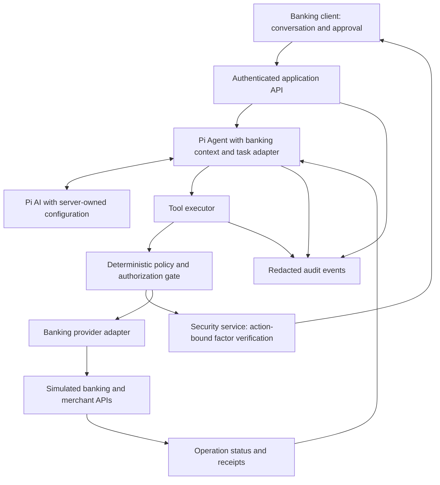

# Banking Agent Design

## Status and Product Direction

Design baseline established by Codex on October 3, 2026 using AIR and the official competition explanation. The owner directed mature minimal framework reuse, then assigned backend work to Codex and frontend work to Claude Code. Backend implementation now uses Pi Agent core/Pi AI 1.0.1, TypeScript/Fastify and Node >=24.19 with SQLite. Inference is API-only, using DeepSeek for testing. API.md and FRONTEND_HANDOFF.md document implemented boundaries. Final competition scope/client format, frontend framework, hosting and real integrations remain open.

Build an assistant embedded in a simulated retail banking application. A customer describes an outcome; the assistant retrieves authorized account context, plans dependent steps, obtains required approvals, executes supported operations, and returns verifiable receipts. Conventional account and transaction screens show the same underlying state.

## Reference and Evidence

- Owner-provided [AIR discussion](chatgpt-conversation://6ac09880-f980-83ea-b808-f0cbf82a0a0d): all three available turns were read as reference material, not verified specifications.
- [Revolut product description](https://www.revolut.com/blog/post/air-ai-by-revolut/), checked October 3, 2026: in-app spending analysis and card/subscription actions; sensitive actions require biometric approval.
- [Pavel Nesterov's AIR engineering description](https://www.linkedin.com/posts/nesterovpavel_this-is-air-activity-7448087433067397120-QtkX), checked October 3, 2026: product sub-agents, a centralized model gateway, and shared orchestration/context/safety capabilities.
- Exact AIR model vendors and deployment topology are not established by these sources. A backend runtime is our architecture choice. Do not infer AIR's provider from unrelated partnerships or equate its chat model with PRAGMA. AIR's privacy and authentication guarantees do not automatically apply here.
- Competition constraints and unresolved organizer questions are in [REQUIREMENTS.md](REQUIREMENTS.md).
- The official problem explanation is the security baseline. [AIR_GAP_REVIEW.md](AIR_GAP_REVIEW.md) records the deeper AIR/platform evidence review, source limitations, unresolved competition alignment, and proposed contracts/evaluations needed to close design gaps.
- Pi source research, reuse boundaries, integration hooks, and attribution are in [PI_INTEGRATION.md](PI_INTEGRATION.md). Reuse the upstream generic loop and model API; implement only the required banking/client/security adaptation.
- Owner-confirmed payment verification and Passkey recovery requirements are in [SECURITY.md](SECURITY.md). Its policy supersedes generic simulated-factor placeholders and adds fresh verification to every transfer/payment.

## Project Scope

Deliver one complete competition submission. The delivery order below describes dependencies within the work, not a roadmap of separate product versions.

| Domain | Included capabilities | Boundary |
| --- | --- | --- |
| Transfers | Resolve seeded contacts by name/phone/note; clarify ambiguous recipients; prepare and execute an immediate CNY transfer; retrieve status and receipt | Simulator accounts and funds only |
| Bill analysis | Backend-calculated category totals; comparable-period changes; unusual/recurring charge candidates; monthly report linked to transactions | Candidates do not prove fraud, duplicate service, or non-use |
| Subscription management | Confirmed subscription lookup; next-renewal display; cancel a seeded merchant subscription or revoke a simulated debit mandate | Merchant cancellation and mandate revocation use distinct tools and receipts |

Card loss reporting/restoration is an optional scope candidate. Investment purchase, scheduled transfers, AA collection, reminder delivery, travel purchases, voice, and external IM channels are outside the current design scope. Cross-domain orchestration uses the three included domains.

## Client Experience

Start with a responsive banking web application designed for mobile use. Verify competition acceptance of this application/channel format; a native client or IM integration is not assumed complete.

- Account overview, transactions, subscriptions, and an assistant entry point use the same backend data.
- Conversation shows evidence-linked analysis, a readable task preview, confirmation cards, verification prompts, progress, and receipts.
- Approval controls display the exact operation, recipient/merchant, amount/currency, and consequences. Generic "yes" text cannot authorize an ambiguous or changed action.
- Every transfer/payment opens an operation review with a Verify and Transfer/Pay action, invoking Passkey user verification or a permitted password route. Factors are entered outside assistant chat. Red-risk password fallback requires an additional action-bound factor.
- A security center supports multiple Passkeys, revocation, unavailable-key recovery using existing-phone SMS plus password, and clear recovery-restriction status. Support synchronized/other usable keys before treating device migration as lost-key recovery; details are in SECURITY.md.
- Customers see understandable steps. A separate restricted reviewer view shows redacted audit and execution events.
- UI text, prompts, fixtures, examples, and code artifacts remain English under AGENTS.md.

## Architecture

The approval path pauses execution. Resume only after server verification and policy re-evaluation. Every write, including a direct application API request, passes the same authorization gate. The model never receives unrestricted banking credentials.

| Component | Responsibility |
| --- | --- |
| Client | Input, task display, authenticated approval/verification interaction, result display |
| Application API | Derive customer identity; enforce ownership/reviewer roles; delegate factors, Passkey lifecycle, recovery, and grants to the security service |
| Agent runtime | Reuse Pi Agent; adapt scoped context and business task persistence, dependencies, clarification, and recovery |
| Model adapter | Reuse Pi AI; configure the selected model, minimized context, deadlines, budget, and usage/latency metadata |
| Policy/executor | Validate ownership and parameters, determine risk, enforce proof requirements, idempotency, deadlines, and circuit breakers |
| Banking provider | Authoritative balances, transactions, subscriptions, atomic ledger changes, operation status, and receipts |
| Audit store | Redacted plans, policy decisions, authorization events, and execution results; restricted access |

Use one application backend with explicit modules. The simulator can share its development process behind an adapter. The backend can run locally now and on a server later; backend ownership does not require cloud hosting. Model inference location is a separate choice.

Use one orchestrator with transfer, bill, and subscription tool groups. AIR's sub-agent pattern informs domain boundaries; independent autonomous sub-agents and microservices are unnecessary for this scope.

Register banking tools through Pi's existing contracts and use its hooks/events for coordination. The shared business executor remains the final authorization boundary. Approval waiting persists an action and ends the run; resumption uses verified backend proof and canonical results. See PI_INTEGRATION.md for mixed-batch termination and parallel-execution semantics that require explicit configuration.

## Tool, Data, and Authorization Contracts

- Read tools return typed data, source record IDs, and observation timestamps. Writes return operation IDs, statuses, and receipts when available.
- A proposed action contains server-derived customer identity, tool name, canonical parameters, plan version, dependencies, and an idempotency key.
- Server-verified authorization expires and binds to one action/version, parameters, session, purpose, and security epoch. Every transfer/payment requires fresh factor verification under SECURITY.md; red-risk password fallback adds a second factor. A client-supplied `approved=true` is insufficient; changing amount or recipient invalidates proof.
- Validate model output against schemas. Allowlist tools; bound input/output sizes, request duration, step counts, and retries. No arbitrary shell, code execution, or unrestricted SQL tools.
- Store money in integer minor units. Backend calculations supply totals; generated prose cannot set balances or declare execution success.
- Core records: customers, accounts, contacts, ledger entries/transactions, subscriptions, debit mandates, tasks, actions, authorizations, receipts, and audit events. Security records add password verifiers, Passkey public keys/status, sessions, purpose-bound challenges, account security epochs, and recovery restrictions. Simulated merchant APIs own merchant subscription status.
- The provider adapter separates reads, preparation, authorized execution, and status lookup. An official sandbox can replace the simulator after its scope and authorization are defined.

## Permission and Reliability Rules

- Green: authorized balance, transaction, and bill queries execute automatically.
- Yellow: immediate transfers with projected daily cumulative total at or below CNY 1,000 and confirmed subscription lookup/cancellation require explicit confirmation. The problem specifically lists subscription queries as yellow; recurring-charge analysis remains part of green bill analysis.
- All transfers/payments additionally require fresh Passkey or permitted account-password verification, including yellow-risk transfers. Red: projected daily transfer total above CNY 1,000 requires an eligible user-verifying Passkey or password plus a purpose-bound second factor; optional card loss reporting/restoration also uses red verification.
- Simulator calendar days use Asia/Shanghai. Atomically evaluate completed outgoing transfers plus pending reservations and the proposed amount. Unknown results retain reservations; refunds do not reduce daily usage in the initial conservative policy. These accounting details are prototype rules, not claims about banking regulation.
- Re-evaluate risk and balances immediately before execution. Concurrent or split transfers cannot bypass verification. A yellow-to-red upgrade pauses for stronger proof.
- Atomically enforce balance, reservation, and idempotency. Reuse the action key on retries; never issue a fresh payment solely because a response timed out.
- Unknown outcomes enter `RECONCILING`; inspect provider status before retrying or releasing dependencies. Preserve completed results on partial failure.
- Cancellation stops unexecuted steps. A committed transfer stays recorded; a later refund/reversal would be a separately authorized operation, not a fictional rollback.
- Use a bounded task failure budget and sensitive-operation lock on suspicious activity; review/resumption requires authenticated controls.
- SECURITY.md defines actual WebAuthn/password verification and a real-provider or explicitly labeled SMS test adapter. The security service verifies factors independently of Pi. Recovery restrictions override all payment authorization methods and invalidate prior approvals; production authentication assurance and organizer acceptance remain unverified.

Persist task/action states and DAG edges: `PLANNED`, `WAITING_FOR_CLARIFICATION`, `WAITING_FOR_CONFIRMATION`, `WAITING_FOR_VERIFICATION`, `EXECUTING`, `RECONCILING`, `SUCCEEDED`, `FAILED`, `CANCELLED`, and `NEEDS_REVIEW`. A restart must not lose an authorized action or duplicate a completed one.

## Context, Knowledge, and Privacy

- Retrieve scoped account context for each decision. Chat history cannot override fresh balances, ownership, or approval rules. Isolate context by authenticated customer and session.
- Use a small versioned set of application policy/product descriptions. Live banking data comes through tools. Defer vector search and cross-session personalization until justified; persistent preferences need explicit retention/deletion rules.
- Treat merchant names, transaction notes, documents, and tool text as untrusted data. Embedded instructions cannot grant permissions. Backend gates remain effective if the model misreads content.
- External models receive only necessary, minimized context. Exclude credentials, verification codes, approval proofs, and unnecessary identifiers from prompts/logs; credentials belong in external configuration.
- Audit structured plans and policy decisions rather than hidden model reasoning. Define redaction, access, and retention. Claim no external-model zero retention until the selected provider's applicable terms/configuration are verified.
- No generated-code execution is planned. Document the constrained tool surface in the security self-assessment and clarify the organizer's sandbox requirement. Add isolated execution only if a confirmed feature requires it.

## Demonstration and Acceptance

Use reproducible synthetic fixtures and injectable failure modes. Example:

> Explain why I spent more this month, show possible duplicate subscriptions, cancel the subscription I select, and send CNY 300 to Alex for shared rent.

Analyze verified transactions, obtain confirmation for subscription lookup, explain candidates, wait for selection, obtain distinct mutation approvals, clarify an ambiguous Alex, execute approved actions, and verify receipts. Ordinary application screens show matching results. Independent steps may complete while others await clarification; the DAG determines dependencies explicitly.

| Case | Required evidence |
| --- | --- |
| Bill report | Category/period totals match fixtures; monetary claims link to records |
| Ambiguous recipient | No transfer before exact account selection |
| Daily boundary | CNY 1,000 is yellow; CNY 1,000.01 is red |
| Concurrent/split requests | Pending reservations prevent verification bypass |
| Changed/replayed/expired approval | No unauthorized mutation; fresh proof required |
| Payment factor and recovery | Fresh action-bound password/Passkey/TOTP proof; wrong/revoked credentials rejected; adaptive backup recovery without routine funds holds under SECURITY.md |
| Injection or another customer's ID | No policy bypass or customer data disclosure |
| Timeout/retry | Status reconciliation and exactly one ledger mutation per action key |
| Partial failure/cancel/restart | Truthful completed steps and safe pending-step recovery |
| Subscription operation | Merchant cancellation differs from debit revocation |
| Unsupported request/provider failure | Explicit limitation/failure; no fabricated execution |

Release gate: all defined authorization/ledger invariants pass. Report measured task completion, clarification rounds, and latency over a versioned evaluation set; no invented performance percentages. Backend runtime/security tests have run; their exact commands/results and remaining unverified behavior are in HANDOFF.md. Live model task evaluations and the frontend demonstration remain outstanding.

## Delivery Order

1. Define fixtures and provider contracts; build deterministic simulator operations and ledger checks.
2. Build one transfer path with all risk levels, proof verification, receipts, and timeout recovery.
3. Connect the upstream Pi runtime/model API and structured planning through thin adapters around the verified executor.
4. Add bills, subscriptions, cross-domain DAG, and the complete client flow.
5. Run reproducible evaluations; prepare technical/security documents, slides, and a short video.

The backend packages, HTTP framework and storage are now selected and implemented. Next integrate the client, configure/evaluate the DeepSeek API and complete end-to-end demonstrations. Resolve organizer acceptance of the client, simulator, verification and sandbox boundary before submission. Commits, pushes, releases, deployment and real banking integration still require explicit owner authorization.
